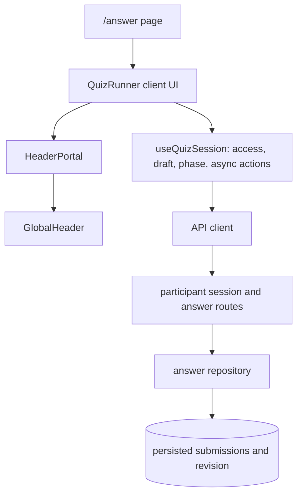

# 回答 UX 軽量化の基準記録

- **対象計画:** [shared plan 62](../../shared_plan/62-SIMPLIFICATION_UX_LIGHTENING_PLAN.md)
- **記録日:** 2026-10-13
- **範囲:** 回答者向け `/answer` の現行挙動、責務、未確認事項
- **実ユーザー観察:** 未実施
- **この記録でのブラウザー計測:** 未実施
- **実装後の自動検証:** 2026-10-13 JST に実施。詳細は末尾の実装後検証記録を参照

## 既存記録と今回の確認範囲

[Plan 54](../../shared_plan/54-UX_SIMPLIFICATION_REFACTORING_PLAN.md) の記録には、対象 unit **214/214**、answer E2E **30/30** の成功がある。これは Plan 54 実施時点の過去結果であり、この記録作成や shared plan 62 の実装時に実行した結果ではない。

### 初回インベントリ

Plan 54 の過去記録には対象 unit **214/214**、answer E2E **30/30** の成功がある。この数字は Plan 54 実施時点の結果であり、shared plan 62 の実装・検証結果ではない。

実装着手時の調査では、既存 answer UI/state テストに320px、Q5、5問最終確認、keyboard/focus、401再認証、409後の draft 保持が含まれていた。375pxの専用フロー、browser Back 後の再訪、未回答から編集して送信する一連の E2E は、この初回インベントリ時点では未確認だった。テストによる確認は代理ブラウザー確認と区別し、実ユーザー観察とは扱わない。

### 後続 E2E による確認

2026-10-13 JST の matrix run `pnpm test:e2e tests/e2e/answer.spec.ts` は **36 total: 34 passed, 2 skipped**。すべての幅を viewport height **812px** にそろえ、横幅の影響を切り分けた。Chromium の 320 / 375 / 1280 と Mobile Chrome の 375 は測定付きで通過し、各条件で19 scripted interactions、question fetch 1回、batch submission 1回、高さ・visibility・overflow assertions が pass した。Mobile Chrome の320 / 1280 matrix cases は skip され、測定値はない。

375×812 の各 browser flow は、未回答からの回復 → 回答 → Q5 の展開 → 最終確認での編集 → 1回の送信を実行した。各 `scrollY` checkpoints は自動ブラウザーの scroll position proxy であり、人の実際のスクロール距離・負荷ではない。修正/編集経路の再訪はこの flow で扱った。**browser Back による履歴移動後の再訪は別条件であり未確認**。

| Browser / viewport      | scrollY checkpoints                 | document height checkpoints            | maxObservedScrollY |
| ----------------------- | ----------------------------------- | -------------------------------------- | -----------------: |
| Chromium / 320×812      | `[0, 2618, 3839, 2170, 2170, 4683]` | `[4188, 4651, 4651, 4525, 5495, 5495]` |               4683 |
| Chromium / 375×812      | `[0, 2518, 3479, 2144, 2144, 4187]` | `[3935, 4291, 4291, 4237, 4999, 4999]` |               4187 |
| Chromium / 1280×812     | `[0, 2568, 3367, 2213, 2213, 3659]` | `[3901, 4179, 4179, 4125, 4471, 4471]` |               3659 |
| Mobile Chrome / 375×812 | `[0, 2518, 3479, 2144, 2202, 4187]` | `[3935, 4291, 4291, 4237, 4999, 4999]` |               4187 |

| 対象                                          | 記録                                                                                                                  |
| --------------------------------------------- | --------------------------------------------------------------------------------------------------------------------- |
| matrix 結果                                   | 36 total、34 passed、2 skipped（Mobile Chrome / 320 と 1280）                                                         |
| 各通過条件                                    | height 812、19 scripted interactions、question fetch 1回、batch submission 1回、visibility / overflow assertions pass |
| Q5 長文、最終確認、keyboard/focus、401、409   | 既存・追加の proxy tests で確認。スクリーンリーダー実機確認なし                                                       |
| browser Back 後の履歴再訪                     | 未確認                                                                                                                |
| 実ユーザーの迷い、人の scroll effort、UX 効果 | 未観察・未測定                                                                                                        |
| 性能と変更前後の比較                          | render/応答/JavaScript/API wait の計測なし                                                                            |

自動 browser matrix による再現可能な proxy 確認は実施したが、実ユーザー観察がなく、人の scroll effort や混乱箇所も測定していないため、UX 効果は未検証である。自動 browser scrollY proxy 値をユーザーのスクロール距離と解釈しない。性能値や同条件の前後比較もないため、性能差は未検証であり改善を主張しない。

## 依存関係

P1 では `QuizRunner` 内で、現在の draft を回答済みか判定する同じ式が未回答一覧、設問ナビ、最終確認で重複していたため、純粋な `hasAnswer` 判定にまとめた。hook、API、保存、revision、focus/ref、DOM の所有者や依存方向は変えていない。`deriveAnswerUi` は単一呼び出しのままにしている。

## 状態と責務の所有

| 状態 / 責務                                                 | 所有者                                                                      | 補足                                                          |
| ----------------------------------------------------------- | --------------------------------------------------------------------------- | ------------------------------------------------------------- |
| 認証・参加者・回答対象 access                               | `useQuizSession`                                                            | 所有者/代理対象の解決と遷移                                   |
| 未確定の選択・自由記述 draft                                | `useQuizSession`                                                            | `QuizRunner` は値を表示し、選択/入力操作を hook に渡す        |
| legacy fifth-answer marker と保存済み selection             | `useQuizSession`                                                            | legacy は通常の選択肢や空 draft と同一視しない                |
| canonical submission、revision、operation と保存/API 副作用 | `useQuizSession` と API/repository                                          | draft とは別の状態。409 後も自動送信しない                    |
| 表示 phase と answer UI の派生表示                          | `useQuizSession` が phase を所有し、`QuizRunner` が `deriveAnswerUi` を導出 | `deriveAnswerUi` は一度だけ呼び出す                           |
| draft の回答済み表示判定                                    | `QuizRunner` の pure `hasAnswer`                                            | 選択 index が `0` でも回答済み、trim 後に空の自由記述は未回答 |
| DOM、question refs、submission handoff focus                | `QuizRunner`                                                                | 既存の要素 ID、ARIA、focus 動作を維持                         |
| durable answers と revision の最終確定                      | answer API / answer repository                                              | クライアント表示判定とは別の保存契約                          |

この表は現在の境界を記録するもので、新しい状態所有者や API 境界を追加する提案ではない。

## 実装後の検証記録

**実行日:** 2026-10-13 JST

| 検証                                                   | 結果                                                                                                                                                                                                 |
| ------------------------------------------------------ | ---------------------------------------------------------------------------------------------------------------------------------------------------------------------------------------------------- |
| 回答 unit / state tests（5ファイル）                   | 257/257 passed                                                                                                                                                                                       |
| Answer E2E matrix                                      | 36 total、34 passed、2 skipped。Chromium 320 / 375 / 1280 と Mobile Chrome 375 は通過。Mobile Chrome 320 / 1280 は skip                                                                              |
| `pnpm lint:fast`                                       | passed。初回は未変更の presentation ファイルに warning のみ、2回目は warning なしで完了                                                                                                              |
| `bash scripts/check-spec-refs.sh`                      | passed                                                                                                                                                                                               |
| `pnpm format:check`                                    | failed。既存の未変更ファイル `docs/operations/jev-q5-fulfillment-run-artifact-v2.schema.json`、`docs/operations/jev-q5-score-gap-run-artifact.schema.json`、`scripts/run-jev-q5-pilot.ts` のみが対象 |
| `pnpm type-check:fast`                                 | failed。実装ファイルのエラーを解消後、既存の未変更 `scripts/run-jev-q5-pilot.ts` に `TS18046`（`unknown`）エラーのみ残存                                                                             |
| `pnpm exec tsgo --noEmit -p ./.tsconfig.jev-temp.json` | passed。上記の既存 JEV pilot file を除外した scoped type-check。temporary config は実行後に削除済み                                                                                                  |
| 変更ファイルの targeted format                         | passed                                                                                                                                                                                               |

今回の実装依頼は、shared plan 62 作成時点の「この依頼での実装は非対象」という記載に優先する、ユーザーの明示指示に基づく。matrix は実行可能な browser proxy 条件を確認したが、実ユーザーによる UX 効果の評価ではない。実ユーザー観察と性能測定・変更前後比較は未実施のため、UX 効果と性能差は引き続き未検証である。

## UX reference audit（2026-10-13）

以下の公的資料を、実装を評価する観点として参照した。原則は評価項目を示すものであり、テストの一部が通ったことだけで WCAG 適合や UX 改善を主張しない。

| 原則・参照                                                                                                                                                                                                                   | この回答フローで確認できる証拠                                                                                                                                                                     | 証拠の限界                                                                                                                                                          |
| ---------------------------------------------------------------------------------------------------------------------------------------------------------------------------------------------------------------------------- | -------------------------------------------------------------------------------------------------------------------------------------------------------------------------------------------------- | ------------------------------------------------------------------------------------------------------------------------------------------------------------------- |
| [WCAG 2.2 1.4.10 Reflow](https://www.w3.org/WAI/WCAG22/Understanding/reflow.html)：縦スクロール内容を320 CSS px幅で、情報・機能の損失や二方向スクロールなしに提示すること                                                    | [`answer.spec.ts`](../../tests/e2e/answer.spec.ts) の Chromium 320×812 でQ5長文の折返しと横overflowなしを確認。Chromium 375/1280、Mobile Chrome 375も同じ高さで確認                                | 320 CSS pxのbrowser viewport確認は、1280 CSS px幅の400% zoom確認と同一ではない。200% zoom、他ズーム倍率、全コンテンツの視認性は包括確認していない。適合判定ではない |
| [WCAG 2.2 2.1.1 Keyboard](https://www.w3.org/WAI/WCAG22/Understanding/keyboard.html)：機能をキーボードで操作可能にする                                                                                                       | 320 E2E は未選択radioにfocusを置き、Spaceでunchecked→checkedとなりnavが回答済みになることをassert。最新runは36 total、34 passed、2 skippedで、このkeyboard testはChromiumとMobile Chrome双方でpass | skipは幅matrixのMobile Chrome 320/1280のみ。19 scripted interactionsは人の全キー経路・任意の操作順を網羅せず、手動の全ページ逐次keyboard巡回も未実施                |
| [WCAG 2.2 2.4.7 Focus Visible](https://www.w3.org/WAI/WCAG22/Understanding/focus-visible.html)：キーボード操作時にfocus indicatorを可視にする                                                                                | E2E はvisible focusの存在をassertし、focus handoff tests は設問移動・送信後の行先を確認                                                                                                            | 視認性、色とのcontrast、focus indicatorが全状態で認識しやすいかを手動評価していない                                                                                 |
| [WCAG 2.2 2.4.11 Focus Not Obscured (Minimum)](https://www.w3.org/WAI/WCAG22/Understanding/focus-not-obscured-minimum.html)：focusされた要素が著者作成コンテンツに完全に隠れない                                             | 320 E2E でsticky headerによる設問navigationのobstructionを確認。設問headingへのfocus targetも確認                                                                                                  | 自動位置・可視性assertionは全viewport/全focus順の手動巡回ではない。実際に使う人の見つけやすさやpartial obstructionの許容性は測っていない                            |
| [WCAG 2.2 2.5.8 Target Size (Minimum)](https://www.w3.org/WAI/WCAG22/Understanding/target-size-minimum.html)：pointer targetは原則24×24 CSS px以上、または定められた例外を満たす                                             | 320 E2E は設問navigation targetを44×44 CSS px以上として検査した。これは本プロジェクトのローカル閾値                                                                                                | 44pxはローカルテスト閾値で、WCAG 2.5.8の要求値ではない。実際のpointer/touch入力誤操作は測定していない                                                               |
| [WCAG 2.2 4.1.3 Status Messages](https://www.w3.org/WAI/WCAG22/Understanding/status-messages.html)：statusをfocus移動なしにprogrammatically判別可能にする                                                                    | [`quiz-runner.tsx`](../../src/app/answer/quiz-runner.tsx) はstatus role / polite live messageを使い、未回答・送信状態のテストがある                                                                | DOM role/ARIAとテストは支援技術による実際のannounce内容、タイミング、重複・聞き逃しを証明しない。screen reader実機確認なし                                          |
| [WCAG 2.2 3.3.1 Error Identification](https://www.w3.org/WAI/WCAG22/Understanding/error-identification.html)：検出した入力エラーを特定し、テキストで説明する                                                                 | answer UI/state tests は未回答、401再認証、409競合、通信失敗、retry等の説明用alert/statusとdraft保持を確認                                                                                         | 認証/通信/競合の状態表示は入力フィールドのvalidation errorと同じではない。field-level error識別の網羅や読み上げ確認、WCAG適合判定はしていない                       |
| [WAI Forms: User Notification](https://www.w3.org/WAI/tutorials/forms/notifications/) / [Validating Input](https://www.w3.org/WAI/tutorials/forms/validation/)：送信成功・失敗と修正方法を簡潔に通知し、入力を寛容に検証する | 未回答案内、回答確認、成功完了表示、エラー後のretry、draft保持を既存state/E2E testsで確認                                                                                                          | 文言の理解度、通知の優先度、実スクリーンリーダーでの通知品質は観察していない                                                                                        |
| [GOV.UK Design System: Question pages](https://design-system.service.gov.uk/patterns/question-pages/)：1ページで質問を明確にし、heading・回答・continueを示すパターン                                                        | 各questionにheadingと回答群があり、sticky navigationで設問間を移動できる                                                                                                                           | 現行の検定は5問を同じ回答フローに表示しており、この1問ごとのページパターンを採用しているわけではない。分割の必要性は実ユーザー調査なしに判断できない                |
| [GOV.UK Design System: Check answers](https://design-system.service.gov.uk/patterns/check-answers/)：送信前の一覧確認と修正経路を用意する                                                                                    | review editからQ5を展開・編集し、最後にbatchを1回だけ送る375×812 flowを確認。未回答案内もある                                                                                                      | proxy flowは情報を見つけられるか、誤りを発見するか、自信を高めるかを示さない。confidence/error-rateの比較なし                                                       |

### UX 判断と追加検証

この資料とDOM/E2E proxyだけから正当化できる具体的なP2 UI変更はない。P2は観察可能なユーザー負荷が特定されていないため、引き続き見送る。今回の自動検証が確認するのは特定経路での動作・寸法・DOM状態であり、findability、混乱、mental workload、実際のscroll effort、理解度、screen-reader announcement quality、UX impactではない。

次の実行可能な確認は、browser Back後の再訪、320 CSS pxと200% zoomを別々にしたreflow確認、全キーボード経路とsticky-header focus可視性、contrast、full assistive-technology巡回を記録すること。人による追跡確認では、回答者が未回答案内・主操作・review editを探す課題を実際に行い、迷い/誤操作/理解、実際のスクロール行動と定性的な説明を観察する。表示変更はその観察で具体的な負荷が示された場合に検討し、効果を述べるなら同条件の前後比較を別途行う。

この監査はWCAG適合性監査でもユーザー研究でもなく、UX改善を示す結果でもない。
